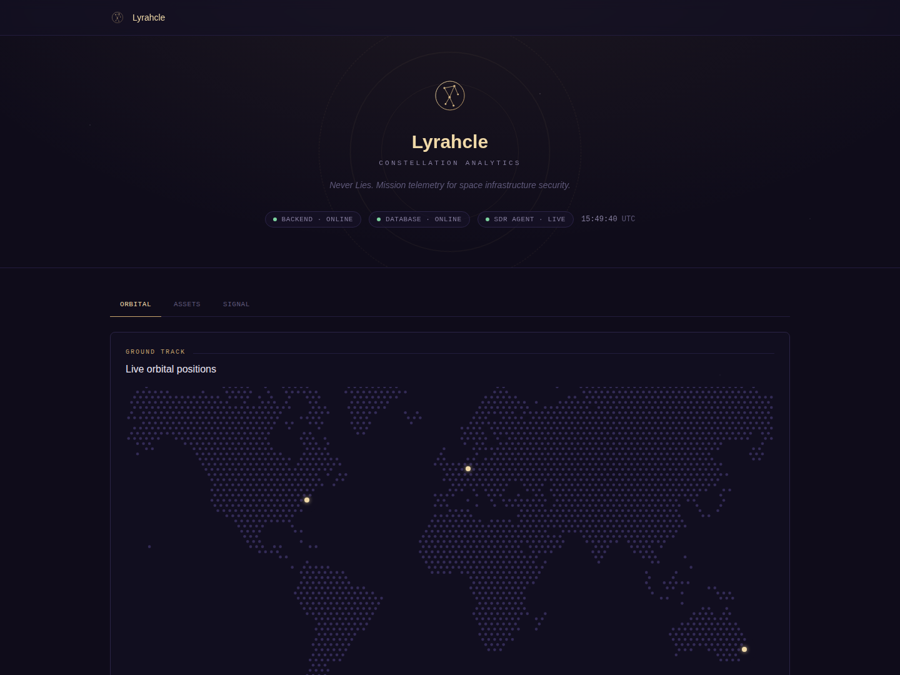

<p align="center">
  
</p>

<h1 align="center">Lyrahcle</h1>
<p align="center"><b>Space cybersecurity operations for ground stations, SDR fleets, and satellite missions.</b></p>

<p align="center">
  <a href="https://github.com/Lyrahcle/lyrahcle/actions/workflows/ci.yml"></a>
  <a href="https://github.com/Lyrahcle/lyrahcle/releases"></a>
  <a href="./LICENSE"></a>
  <a href="./.github/workflows/ci.yml"></a>
</p>

Teams operating satellites and ground infrastructure often lack the RF and orbital security visibility that terrestrial SOC teams take for granted. Lyrahcle brings RF telemetry, orbital context, threat intelligence, incident response, and hardened SDR-agent operations into one operator-focused platform.

<p align="center">
  
</p>

## What it includes

- Live orbital tracking with TLE synchronization, SSE updates, and orbital-aware RF correlation.
- RF ingestion, anomaly detection, signed detection rules, incident correlation, and IQ forensic replay.
- AX.25, CCSDS, PUS, and CSP decoding plus NVD-backed space CVE intelligence.
- Secure SDR fleet management with enrollment, mTLS identity, certificate lifecycle, and signed remote configuration.
- Multi-tenant organizations with database-enforced row-level isolation and a dedicated platform-administrator boundary.
- JWT sessions, Google Authenticator TOTP, WebAuthn security keys, granular per-organization RBAC with custom roles, audit logging, and request/trace IDs.
- Prometheus, Grafana, optional OpenTelemetry export, SBOMs, signed releases, and build provenance.

## Quick start

> **Local evaluation only.** The default development bootstrap credentials must never be used for an Internet-facing or production deployment.

```bash
git clone https://github.com/Lyrahcle/lyrahcle.git
cd lyrahcle
./scripts/docker-local-up.sh
```

Open `http://localhost:5173`. Unless overridden, local development starts with `admin` / `admin`; that account is restricted until its password is changed.

Observability and the mock SDR agent are opt-in profiles:

```bash
./scripts/docker-local-up.sh --profile observability
./scripts/docker-local-up.sh --profile sdr
```

**Contributions are welcome.** Start with [`CONTRIBUTING.md`](./CONTRIBUTING.md), then check the [development plan](./PLAN.md) and [improvement roadmap](./docs/improvement-roadmap.md).

## Architecture

| Service | Purpose |
|---|---|
| `apps/backend` | Go API, identity, RF/orbital correlation, incidents, Postgres/Redis |
| `apps/frontend` | React/Vite operator dashboard |
| `apps/sdr-agent` | Edge RF collection, mTLS identity, signed remote configuration, forensics |
| `apps/cve-sync` | NVD ingestion and CVE publishing |

See [`docs/architecture.md`](./docs/architecture.md) for trust boundaries and data flows.

## Security and documentation

The backend enforces authorization; frontend visibility is never treated as a security boundary. SDR agents use individual mTLS identities, remote configuration is signed independently with Ed25519, and CI gates include tests, race detection, vulnerability checks, fuzzing, critical-package coverage, image scanning, SBOM generation, and release signing.

Start at [`docs/README.md`](./docs/README.md). Useful entry points include the [API reference](./docs/api-reference.md), [deployment guide](./docs/deployment.md), [STRIDE threat model](./docs/ieee3536-threat-model.md), [SDR agent guide](./docs/04-sdr-agent-guide.md), and [orbital security correlation](./docs/orbital-security-correlation.md).

Interactive API documentation is available at `http://localhost:8080/docs` while the backend is running.

## Roadmap

Lyrahcle is pre-v1.0 and under active hardening. Current priorities are physical SDR validation of orbital correlation, pass prediction/AOS-LOS, cross-domain correlation, agent-fleet hardening, production validation, and the remaining v1.0 security/operations gates.

- [Development plan](./PLAN.md)
- [Improvement roadmap](./docs/improvement-roadmap.md)
- [Security roadmap](./SECURITY_ROADMAP.md)
- [Changelog](./CHANGELOG.md)

## License

The core is licensed under AGPLv3. See [`LICENSE`](./LICENSE) and [`SECURITY.md`](./SECURITY.md).
