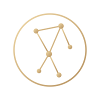

<p align="center">
  
</p>

<h1 align="center">Lyrahcle</h1>
<p align="center"><b>Space cybersecurity operations platform.</b></p>

Lyrahcle combines orbital awareness, RF telemetry, TM/TC decoding, threat intelligence, asset monitoring, and security controls in one operator-focused platform.

## What it includes

- Live satellite tracking with TLE synchronization and SSE updates.
- RF ingestion, statistical anomaly detection, typed detection rules, incident correlation, agent connectivity, and IQ forensic replay.
- AX.25, CCSDS, PUS, and CSP decoding.
- NVD-backed space CVE intelligence with filtering and asset alerts.
- JWT authentication, TOTP, RBAC, revocable agent keys, audit logging, and request IDs.
- React dashboard with light/dark mode and EN/ES/FR/DE localization.

## Quick start

```bash
git clone https://github.com/Lyrahcle/lyrahcle.git
cd lyrahcle
docker compose up --build
```

Open `http://localhost:5173`. For local development only, the bootstrap login is `admin` / `admin` unless overridden with `SEED_ADMIN_EMAIL` and `SEED_ADMIN_PASSWORD`.

To run the mock SDR agent too:

```bash
docker compose --profile sdr up --build
```

## Services

| Service | Purpose |
|---|---|
| `apps/backend` | Go API, auth, orbital/RF logic, alerting, Postgres |
| `apps/frontend` | React/Vite operator dashboard |
| `apps/sdr-agent` | Edge RF agent and IQ capture/replay |
| `apps/cve-sync` | NVD ingestion worker and CVE publisher |

## Documentation

Start with [`docs/README.md`](./docs/README.md).

- [Architecture](./docs/architecture.md)
- [API reference](./docs/api-reference.md)
- [Configuration](./docs/configuration.md)
- [Deployment](./docs/deployment.md)
- [IQ forensics](./docs/forensics.md)
- [STRIDE threat model](./docs/ieee3536-threat-model.md)
- [Compliance checklist](./docs/compliance-checklist.md)
- [Software supply chain](./docs/supply-chain.md)
- [Security policy](./SECURITY.md)
- [Security roadmap](./SECURITY_ROADMAP.md)
- [Contributing](./CONTRIBUTING.md)
- [Releasing](./RELEASING.md)

Interactive API documentation is available at `http://localhost:8080/docs` while the backend is running.

## Development checks

```bash
cd apps/backend && go test ./... && go vet ./...
cd ../frontend && npm test && npm run build
```

CI also runs integration tests, dependency review, vulnerability checks, SDR fuzzing, an >80% critical-package coverage gate, authentication E2E checks, image scanning, and CycloneDX SBOM generation.

## Status

Pre-v1.0. The core platform is functional and actively being hardened. Real SDR hardware integration remains a major pre-v1 milestone.

## License

The core is licensed under AGPLv3. See [`LICENSE`](./LICENSE) and [`SECURITY.md`](./SECURITY.md).
