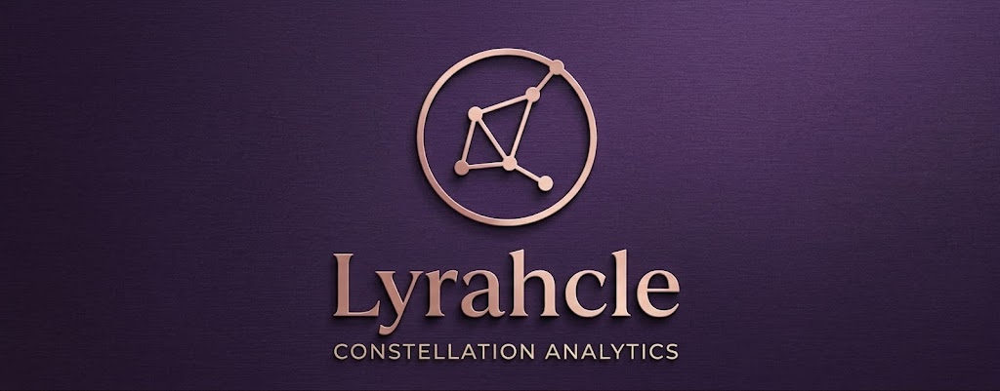

# Lyrahcle — Constellation Analytics

**Never Lies.**

Lyrahcle is a professional space-cybersecurity platform for assessing, monitoring, and
defending space infrastructure: satellites, ground stations, RF links, TM/TC protocols,
embedded firmware, and orbital telemetry.

Lyrahcle follows an **Open Core** model — an open, auditable core (AGPLv3) combined with
paid enterprise modules — aiming for transparency, community, and sustainability.



Maintained by [mlko01](https://github.com/mlko01) — contact: manu.ciberseguridad@gmail.com

## Status

🚧 Early development — Phase 4 (branded dashboard: assets table, live backend status).

## Repository layout

```
lyrahcle/
├── apps/            # Open-core services (backend, frontend, sdr-agent, cve-sync, docs)
├── enterprise/       # Proprietary modules (not published in the public repo)
├── packages/          # Shared MIT-licensed libraries
├── deploy/            # Docker, Helm, Kubernetes manifests
├── scripts/           # Dev / CI utilities
└── docs/              # Technical & user documentation
```

## Licensing

| Component | License |
|---|---|
| Core (backend, frontend, API, basic scanning/monitoring/SDR) | AGPLv3 |
| Enterprise modules (advanced RF, proprietary protocol decoding, SIEM integrations, executive reporting) | Commercial |
| Shared libraries (`rf-lib`, `tle-lib`, `ui-components`) | MIT |
| Documentation | CC BY-SA 4.0 |

See [PLAN.md](./PLAN.md) for the full development plan.

## Getting started

```bash
docker compose up
```

(Enterprise modules: `docker compose -f docker-compose.enterprise.yml up`, requires a license key.)
